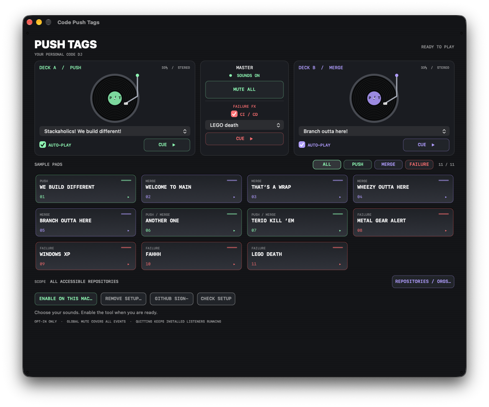
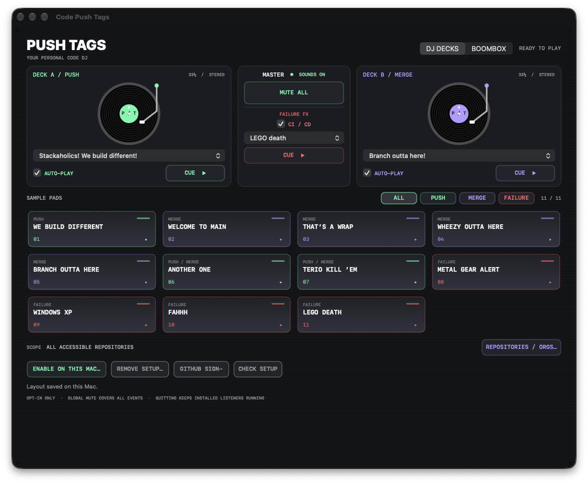
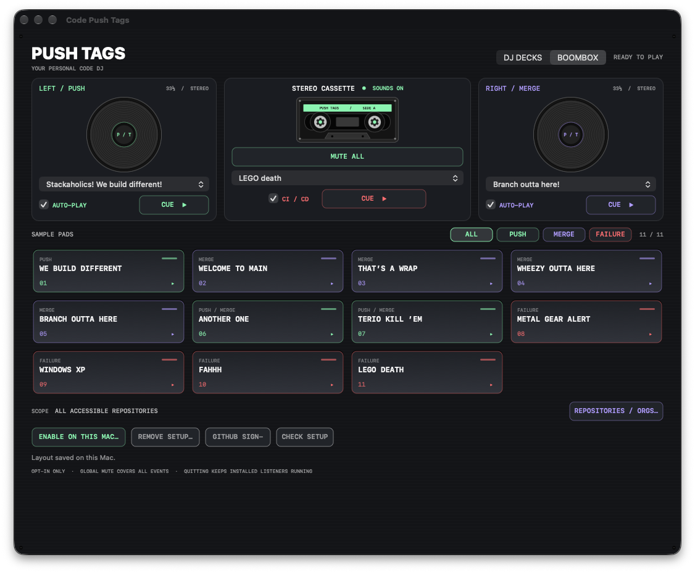

# Code Push Tags: Mac prototype

## Current scope

This is a private prototype for local tests on Max's Mac. It supports Apple Silicon and macOS 12 or later. Intel support is deferred.

Decided by: person (Max). Max requested a small standalone app, local testing before invitations, and Apple Silicon support first.

The app uses the existing Python tools, sound files, and settings. It does not contain a second notification service. Python 3.9 or later and GitHub CLI are required on the Mac.



## Open the prototype

The local app is at `~/Applications/Code Push Tags.app`. Open it from Applications or the Dock. Closing the main window keeps the menu-bar control available. Reopening the app shows the main window again.

Opening the app does not install automatic sounds. Max's existing terminal setup remains active. Sound choices and mute changes use that same local configuration.

## Preview and choose sounds

1. Click a sample pad to preview its clip.
2. Choose a sound on **Deck A / Push**, **Deck B / Merge**, or **Failure FX / CI/CD**.
3. Use the event's **CUE** button to hear that selection.

Only one manual preview plays at a time. Clicking another pad stops the previous clip. Global mute stops an active preview. The controller uses a DJ-table layout, with Push and Merge decks, a center master strip, and sample pads.

Browse sample pads with **All**, **Push**, **Merge**, and **Failure**. These groups do not restrict routing. Each event can use any clip. Choices save locally. The initial defaults are **We build different**, **Branch outta here**, and **LEGO death**. The app saves the displayed choices before a new installation.

Turn global mute off before previewing a clip. Global mute also suppresses manual playback.

## Select repositories or organizations

1. Select **REPOSITORIES / ORGS**.
2. Wait for your accessible GitHub repositories to load.
3. Use **Refresh** if you need a current catalog.
4. Clear **All accessible repositories** to choose a subset.
5. Select individual repositories, organizations, or both.
6. Select **Save selection**.

The chooser opens from a private cached catalog and refreshes in the background. Refresh keeps current checks and search text. Cancel returns to the controller without saving.

Repository and organization selections form one combined set. Selecting an organization includes its accessible repositories, including new repositories. Selecting **None** clears the set. It does not change global mute.

The same selection controls push, merge, and CI alerts. GitHub access still controls which private repositories the app can read. Existing installations keep all repositories until the person selects a subset.

Manual previews do not depend on the repository selection. Excluded merges and CI failures are recorded without sound and do not replay after a selection change.

Decided by: person (Max). Max requested both repository and organization selection, based on each person's access.

## Global mute

Select **MUTE ALL** in the window or use the menu-bar mute. Select **TURN SOUNDS ON** to resume. This setting controls all repositories and event types.

The terminal controls remain available:

```sh
push-tags off
push-tags on
```

Quitting the app does not stop installed background listeners. Use global mute when you want silence.

## Enable or remove

Move the app into `/Applications` or `~/Applications` before enabling it. Select **GitHub sign-in** if needed. Select **Check setup** to inspect prerequisites.

Select **Enable on this Mac** to install the shell source line and background watcher. Confirm the installation. Open a new terminal afterward.

The app preserves an existing terminal installation. It reports that installation instead of replacing it. Both copies use the same preferences. To switch the installed runtime to the app bundle, remove the old setup before enabling the app's copy.

Select **Remove setup** to mute sounds and remove the shell setup and scheduled watcher. Settings and sound files remain.

## CI/CD failure alerts

CI/CD alerts cover GitHub Actions runs attributed to the person's work. Failed and timed-out runs can play a sound. Cancelled runs do not.

The verified attribution signals are:

- The person is the run actor or triggering actor.
- The run uses an exact head or merge commit from a PR the person authored or merged.
- A bot-created follow-up PR uses an exact matching commit and explicitly links to a merged source PR the person authored or merged.

The bot source check follows one verified same-repository link. A shared branch or a nearby timestamp does not establish attribution.

Polling checks current heads of open pull requests and recent completed runs in relevant repositories. It finds those repositories from open PRs, saved merge events, and explicit repository selections. The downstream scan uses a one-day checkpoint overlap. The webhook path verifies completed runs and attribution through GitHub. Both paths share saved run-attempt identities. A failed rerun can alert once for its new attempt. A duplicate delivery does not alert again.

The first CI check sets a baseline without playing old failures. Muted and excluded failures are recorded without replay.

The default CI sound is LEGO death. The library also includes Fahhh, the Metal Gear alert, and the Windows XP error. People can choose another clip.

This covers Actions workflow failures, not every third-party check provider. A signed local replay used a real failed run and the GitHub API. It recorded one event and rejected the duplicate. Read-only checks also traced three real release-chain runs through a bot release PR to Max's source PR. Those release runs succeeded, so they verify attribution rather than failure playback. A new failing deployment has not been triggered for this test.

## Event connections

Coworkers can use polling without webhook administration access. The Mac must remain awake and online. Polling checks once per minute, and GitHub indexing can delay results.

Max's temporary organization listener subscribes to `pull_request` and `workflow_run`. It verifies signatures on a loopback receiver. It filters events for Max and uses the same selected repositories and mute setting.

GitHub's test-forwarding service supports one connection per target. It is for development and testing. A shared service is required before a multi-person webhook rollout.

## Build and verify

Builds normally run in CI under the global instructions. Max explicitly approved the targeted local prototype build and UI test.

Decided by: person (Max). Intel support will follow after this Apple Silicon prototype.

Stage the required runtime files and audio before building. The packager accepts only its fixed runtime allowlist and tracked manifest audio.

```sh
python3 macos/build_app.py --output /private/tmp/code-push-tags-build
```

Use a new output folder. The build creates an Apple Silicon app and `Code-Push-Tags-macOS.zip`. It uses an ad-hoc signature for local testing. It is not Developer ID signed or notarized.

The app bundle excludes credentials, private state, webhook payloads, source-recording caches, and rejected demos. Settings remain in `~/Library/Application Support/Code Push Tags/`. Credentials remain in Keychain.

See [updates and releases](UPDATES.md), [sound sources](SOUNDS.md), and [review evidence](REVIEW.md).

## Layouts and animation

Select **DJ DECKS** or **BOOMBOX** at the top of the window. The app saves this choice in `appearance.json` in its local settings folder. The choice stays after you close the app. Both layouts use the same sound selections, repository filters, and master mute.

The DJ layout has two record decks. The boombox layout has two speakers and a cassette. A successful sound-selection save starts a short animation. During a preview, the record or cassette reels turn. A new preview stops the previous sound and animation. Master mute stops the preview. The app reduces motion when the macOS Reduce Motion setting is on.

Decided by: person (Max). Max requested both layouts, local storage, and record or cassette animation.

| DJ decks | Boombox |
| --- | --- |
|  |  |
