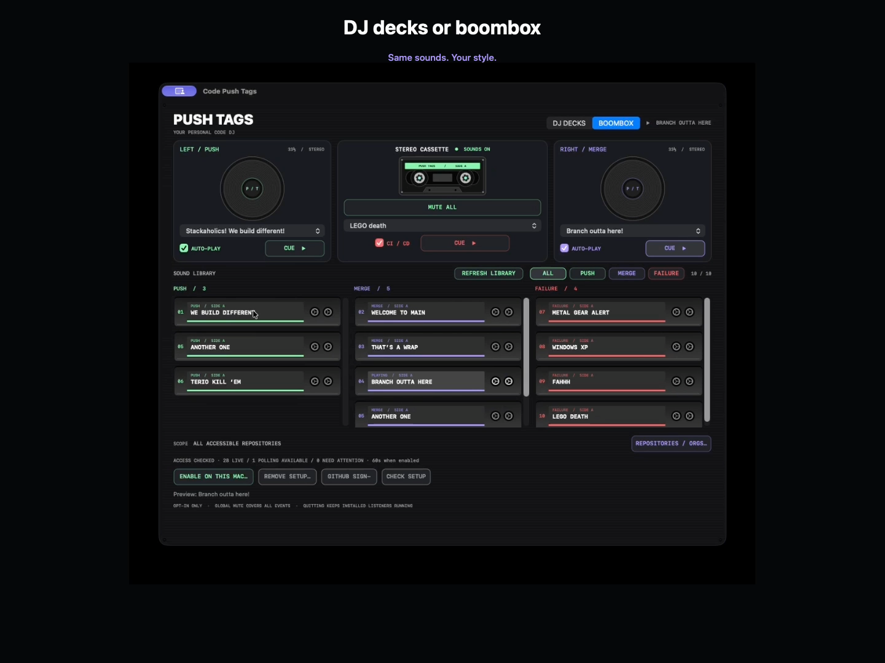

# Code Push Tags

**Start with [INSTALL.md](INSTALL.md).** Download the app, choose your sounds, and enable it when ready.

[Download the DMG](https://github.com/murbany-lola/code-push-tags/releases/latest/download/Code-Push-Tags-macOS.dmg) · [Download the ZIP](https://github.com/murbany-lola/code-push-tags/releases/latest/download/Code-Push-Tags-macOS.zip) · [Watch the trailer](docs/code-push-tags-trailer.mp4)

[](docs/code-push-tags-trailer.mp4)

The [Apple Silicon app](MAC_APP.md) has DJ and boombox layouts, local previews, event choices, global mute, and repository or organization selection. See [updates](UPDATES.md) and the [sound library](SOUNDS.md).

Optional local sounds for successful Git pushes, GitHub PR merges, and attributed GitHub Actions failures on macOS.

Choose a sound for each event from the shared library. Each person installs the tool on their own Mac. There is no team broadcast or automatic enrollment.

## Choose sounds

Use the app's Push, Merge, and Failure groups to browse the library. Double-click a sound to preview it. Use each event's menu to save its sound assignment.

The terminal commands can also list and preview sounds:

```sh
python3 push_tags.py list
python3 push_tags.py play --event push
python3 push_tags.py play --event merge
python3 push_tags.py play --event ci
```

Preview commands use your saved selection when one is available. See [sound sources and library updates](SOUNDS.md) for the available clips. Use `python3 push_tags.py configure --help` for terminal selection options.

## Requirements

Use macOS, zsh, Python 3.9 or later, Git, and GitHub CLI (`gh`). The installation folder must remain at the same path after installation.

## Opt in

Clone this repository into a permanent folder. Open Terminal in that folder. Authenticate your own GitHub account:

```sh
gh auth login
```

Check the required commands and GitHub access:

```sh
python3 push_tags.py doctor
```

Inspect the installation paths:

```sh
python3 install.py plan
```

Enable the tool:

```sh
python3 install.py install
```

Open a new terminal. The installer backs up `.zshrc`, adds a source line, and installs a local launchd job for merge checks. It does not change repository hooks or CI configuration.

To include noninteractive zsh commands, such as ordinary Git calls from a coding agent, use `.zshenv` instead. Use this same path for removal:

```sh
python3 install.py plan --shell-file ~/.zshenv
python3 install.py install --shell-file ~/.zshenv
```

Existing Git functions and aliases are not replaced automatically.

## Mute or remove

One global mute controls all sounds across all repositories and all event types. Open a new terminal once after updating the shell helper.

```sh
push-tags off
push-tags on
```

The original `mute` and `unmute` commands work too. The mute setting persists until you turn sounds on. Muted merges are recorded and are not replayed later.


```sh
python3 push_tags.py mute
python3 push_tags.py unmute
python3 push_tags.py configure --push off
python3 push_tags.py configure --merge off
python3 install.py uninstall
```

If you installed into `.zshenv`, remove that installation with:

```sh
python3 install.py uninstall --shell-file ~/.zshenv
```

Open a new terminal after removal. Audio files and private settings remain on the Mac.

## Trigger behavior

The shell function plays the clip after a successful `git push`. It preserves Git output, exit status, and existing hooks. A successful push with no changes can also play the clip. Audio plays in the background at reduced volume.

The shell function covers Git commands that use the selected zsh startup file. An absolute `/usr/bin/git` command, another shell, or a GUI Git client bypasses it. An explicit command also works:

```sh
python3 push_tags.py push -- origin HEAD
```

The merge watcher checks GitHub once per minute. It confirms that a pull request was merged and that you authored or merged it. The first check sets a baseline without playing old merges. The Mac must be awake and online. GitHub search indexing and event delivery can delay the sound; the event feed can lag by up to six hours and contains at most 300 events.

Mute suppresses playback. The watcher still records events, so unmuting does not replay those events.

## Credentials and settings

The watcher uses your `gh` login. An optional Keychain reference is supported:

```sh
python3 install.py install --keychain-service code-push-tags.github --keychain-account YOUR_GITHUB_LOGIN
```

Create that Keychain item through your normal credential process before use. The installer stores only the item name and account reference. It does not place the token in this repository or the launchd file.

Settings, logs, and merge state are in `~/Library/Application Support/Code Push Tags/`. Keep those files private.

## Checks

```sh
python3 -m unittest discover -s tests -q
zsh -n shell.zsh
```

The unit tests use simulated Git, GitHub, audio, and time responses. They do not push or merge code. These checks do not establish that the tool works with every Git client.

The library contains generated tags and downloaded recordings. See [sound sources](SOUNDS.md) for each clip. This repository grants no rights to third-party recordings or voices.

Sources: [Fenzo guide](https://fenzo.ai/courses/drop-your-producer-tag-every-git-push/hear-it-on-your-OuM3wCUFM), [Git hooks](https://git-scm.com/docs/githooks#_pre_push), and [GitHub event limits](https://docs.github.com/en/rest/activity/events).

## GitHub webhook pilot

The optional webhook pilot receives merge events while GitHub is closed in your browser. It uses GitHub's authenticated CLI forwarding service. It opens no public port on the Mac.

GitHub documents this forwarding service for development and testing only. Only one forwarding session can use a repository or organization at a time. The pilot is for one person. A shared service is required before multiple coworkers can use the same organization listener.

Install the official extension:

```sh
gh extension install cli/gh-webhook --pin v0.2.0
```

Start the personal-repository pilot:

```sh
python3 listen.py --repo murbany-lola/code-push-tags
```

Keep the process running. The Mac must remain awake and online. Stop it with Control-C. The command removes its saved test webhook on normal shutdown. After an interrupted run, it removes that saved hook before starting again. It does not remove an unidentified existing forwarding hook.

The receiver uses port 18769 by default. Choose another port if needed:

```sh
python3 listen.py --repo murbany-lola/code-push-tags --port 18770
```

The token needs hook administration access for the selected target. The command creates one GitHub test hook. A separate signing secret is stored in Keychain under `code-push-tags.webhook`. No webhook secret is written into the repository.

The receiver confirms each merge through GitHub. It only plays events for PRs that the authenticated person authored or merged. Squash merges use this same path. It shares saved events with the polling watcher, so a duplicate delivery does not play again.

The installed polling watcher remains available. It can recover merges after a forwarding interruption. The webhook pilot does not replace or disable it.

An organization pilot uses `--org lola-labs` after the required organization-change approval. No organization hook is enabled by installing or cloning this repository.

Validation: a real squash merge on temporary branches in the personal repository reached the receiver while polling was paused. A second signed delivery returned `recorded: false`. Polling was then restored. The test did not change `main`.

Source: [GitHub CLI webhook forwarding](https://docs.github.com/en/webhooks/testing-and-troubleshooting-webhooks/using-the-github-cli-to-forward-webhooks-for-testing).
